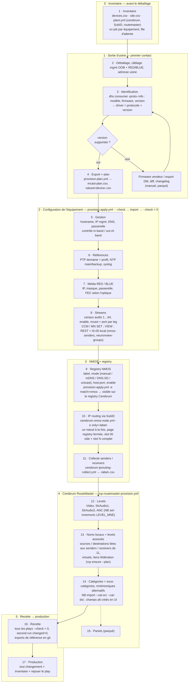
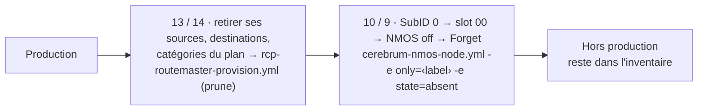

# Provisioning — de l'usine à la production

Chaîne de provisioning d'un équipement (Neuron CONVERT / Shuffler / VIEW,
FusioN) depuis la sortie d'usine jusqu'à son exploitation dans Cerebrum.
Un job par équipement, dans l'ordre de l'inventaire ; les étapes Cerebrum
(10, 12–14) s'exécutent une à la fois, un seul écrivain. Chaque étape est un
play Ansible idempotent : `--check` avant, apply, `--check` = 0 après ; un
second run répond `changed=0`. Aucun réglage à la main sur l'équipement :
l'inventaire d'abord, puis le play. L'équipement est configuré en entier
(gestion, références, média, streams) avant d'être inscrit sur le registry
NMOS : Cerebrum voit le nœud une fois, complet.

## Workflow

## Étapes

| # | Étape | Source de vérité | Outil | Porte (vérifiée avant de passer) |
| --- | --- | --- | --- | --- |
| 1 | Inventaire : ligne `devices.csv` (type, IP mgmt, planes, NMOS label, RED/BLUE, FEC, blocs mcast), `site.csv` (NTP, PTP, registry, syslog), `plant.yml` (`cerebrum`, `cerebrum_nmos_subids`, `cerebrum_routemaster`) | git | — | fichiers commités ; un job par équipement dans la file |
| 2 | Déballage, câblage mgmt OOB + RED/BLUE, alimentation, adresse usine (DHCP ou défaut constructeur) | — | — | l'équipement répond sur le port de contrôle |
| 3 | Identification : modèle, firmware, protocole + version → driver (rôle par protocole + version) | équipement | `dhs consumer ‹proto› info` (`identify.yml`) | la version a un driver ; sinon stop : firmware vendeur ou export DM + diff + changelog (parqué) |
| 4 | Export typé + plan : groupes multicast par sender leg, `values/‹device›.csv` au format export dhs | `types/‹type›.csv`, `mcast-ranges.csv` | `provision-plan.yml` | plan rejoué = 0 ; `values/‹device›.csv` commité |
| 5 | Gestion : hostname, IP mgmt (DHCP/static), DNS, passerelle ; contrôle in-band / out-of-band | `devices.csv` | `provision-apply.yml -e only=‹device›` | joignable sur l'adresse prévue avant de quitter l'ancienne (secours : port live) |
| 6 | Références : domaine + profil PTP, NTP main/backup, syslog | `site.csv` | `provision-apply.yml` | PTP verrouillé (domaine 77), NTP synchronisé |
| 7 | Média RED / BLUE : IP, masque, passerelle, FEC selon l'optique (SR4 = RS des deux côtés, LR4/DR = off) | `devices.csv` | `provision-apply.yml` | liens up sur la fabric, FEC identique aux deux bouts |
| 8 | Streams : nombre de canaux audio (1…64 selon l'équipement), enable / disable, mcast + port par leg, par le protocole natif ; VIEW : REST (groupes d'entrée) + IS-05 sur son node local | `mcast-plan.csv`, `plant.yml` (`nmos_senders`, `neuronview`) | `provision-apply.yml` (CCM / MN SET) ; VIEW : `nmos-senders.yml`, `neuronview-groups.yml` | senders sur leur groupe / port, canaux conformes au plan, enable selon le plan |
| 9 | Registry NMOS : label, mode (manual / mDNS / DNS-SD / unicast), host:port + backup, enable ; VIEW : driver REST. Dernier réglage de l'équipement : il s'inscrit complet | `site.csv` (`registry_*`), `devices.csv` (`nmos_label`) | `provision-apply.yml -e match=nmos` (rôle `dhs_cerebrum_nmos_node` pour le switch) | nœud listé sur le registry Cerebrum (Network Media Server, slot 00), deux lectures identiques |
| 10 | IP routing via SubID : déplacement du nœud sur son slot, un nœud à la fois, page registry fermée | `plant.yml` (`cerebrum_nmos_subids`) | `cerebrum-nmos-node.yml -e only=‹label›` (`state=present`) | slot 00 vide de ce nœud, slot N complet (devices, senders, receivers), deux lectures identiques après settle |
| 11 | Collecte des senders / receivers du slot | Cerebrum | `cerebrum-iprouting-collect.yml` | `‹label›.csv` (slot, device, kind, name) commité : ce sont les noms que le plan RouteMaster lie |
| 12 | Levels RouteMaster : Video, StrAudio1, StrAudio2, ANC — puis, dans l'UI Cerebrum (aucune API, mesuré 2026-10-22 sur 2.9.3) : Levels → Default Device = IP Router, « Multiple Devices » coché quand un level mélange 2110 et une entrée de routeur ; sans cela aucune association IP n'est effective | `plant.yml` (`cerebrum_routemaster.levels`) | `rcp-routemaster-provision.yml` (NB `set-mnemonic --kind LEVEL_MNE`) | `list-levels` = inventaire |
| 13 | Noms locaux + levels associés : sources / destinations liées aux senders / receivers de l'étape 11, virtuels, liens fédération | `plant.yml` (`cerebrum_routemaster.plan`) | `rcp-routemaster-provision.yml` (`rcp ensure --plan`) | chaque écriture relue ; second run `changed=0` ; fédération PENDING tant que le serveur fédéré n'existe pas |
| 14 | Catégories + sous-catégories (texte, catégorie, blanc), mnémoniques alternatifs | `plant.yml` (`categories`, `alternates`, `alternate_fields`) | `rcp-routemaster-provision.yml` (NB `import --cat-src --cat-dst`) | catégories listées = inventaire ; alt appliqués pour les champs qui existent (créés en UI) |
| 15 | Panels | — | parqué | — |
| 16 | Recette : tous les plays en `--check` = 0, second run `changed=0`, exports de référence (`rcp export --plan`, exports équipement) en git | git | tous les plays ci-dessus | zéro changement ; captures Wireshark si besoin |
| 17 | Production : l'équipement est exploité ; tout changement = inventaire puis rejouer le play | git | — | — |

## Chemin inverse (retrait)

## Règles

- Un job par équipement, dans l'ordre de l'inventaire ; Cerebrum n'a qu'un
  écrivain à la fois (étapes 10, 12–14), ses écritures sont relues avant de
  passer à la suivante.
- Le registry NMOS (étape 9) vient après la configuration complète de
  l'équipement (5–8). Tout changement de stream après l'inscription
  (groupe, port, canaux, enable) réécrit le SDP du sender ; le registry le
  republie, le Network Media Server de Cerebrum le relit, l'IP routing du
  slot change, et les ressources RouteMaster liées à ces senders /
  receivers (13) suivent. Le nœud s'inscrit donc une fois, complet, et ne
  bouge plus.
- Page registry du Network Media Server fermée dans l'UI Cerebrum pendant
  l'étape 10 (support EVS).
- Compte Cerebrum : `DHS_CEREBRUM_USER` / `DHS_CEREBRUM_PASS` depuis Vault,
  dans l'environnement du nœud de contrôle ; jamais sur disque ni en ligne
  de commande.
- Un timeout est un bug à diagnostiquer, jamais une valeur à augmenter.
- Étape 5 : ne pas forcer le mgmt en static avant d'avoir confirmé l'accès
  par la nouvelle adresse ; en cas d'échec, reprise par le port live.
- Étape 8 : NeuronView n'a pas de CCM sur ce firmware → REST et IS-05 sur
  son node local, sans registry ; l'export CCM du VIEW attend la correction
  `--api-spec` absolu.
- Étape 9 : un seul registry pour tous les équipements (backup = le même) ;
  Network Media lit un registry externe en v1.3 et cache la FusioN (v1.2).
- Étape 13 : sur un serveur standalone la fédération est acceptée sans être
  appliquée ; `federation_optional: true` jusqu'à l'installation du serveur
  fédéré.
- Étape 14 : les champs de mnémoniques alternatifs n'existent qu'en UI
  (Tally and Router Config View → Alternate Mnemonics) ; le play n'envoie
  que les champs nommés dans `alternate_fields`.
